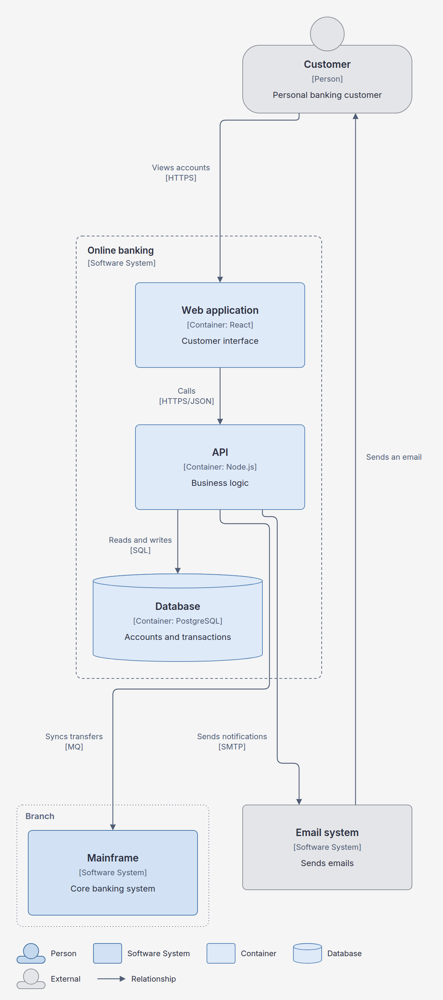

<div align="center">

# C4 Architecture

### C4 diagrams and ADRs as code

*Agents read everything. Humans read what matters.*

[Docs](https://deka.github.io/c4-architecture/) | [Tutorial](https://deka.github.io/c4-architecture/tutorial/) | [Schema](https://deka.github.io/c4-architecture/schema/) | [Examples](examples/)

[](LICENSE)
[](https://nodejs.org/)
[](https://docs.claude.com/en/docs/claude-code/plugins)
[](https://c4model.com/)



</div>

## Highlights

- **Claude Code plugin.** Design the architecture in a conversation, record its decisions, diff it against the code.
- **Strict JSON Schema.** Closed objects and enums: an agent writes a valid model without guessing. Errors point to a JSON Pointer.
- **One model, every view.** Elements and relationships are declared once; context, container, component and dynamic views are derived and never contradict each other.
- **ADRs linked to the model.** One Markdown file per decision, its front matter lists the element ids it concerns. Never edited, only superseded. `c4-drift` flags those the model contradicts.
- **One HTML file.** Inline SVG, embedded font, no JavaScript, CSP `default-src 'none'`. Open it anywhere, commit it next to the code.
- **Readable without pixels.** `inspect` lists what each view shows, so an agent checks its diagrams without seeing them.
- **Small.** TypeScript run directly by Node 24, no build step. Three dependencies: `ajv`, `ajv-formats`, `elkjs`.

## With Claude Code

```text
/plugin marketplace add deka/c4-architecture
/plugin install c4-architecture@c4-architecture
```

Then ask *"Let's design the architecture of an online shop."* Claude asks one question at a time, challenges your choices and writes:

```text
docs/architecture/
├── workspace.json                      # the model
├── workspace.html                      # the diagrams
└── decisions/
    └── 0004-use-postgresql-for-orders.md
```

| Skill | Does |
|---|---|
| `/c4-architecture:c4-design` | Designs the model level by level, before any code exists. |
| `/c4-architecture:c4-drift` | Diffs the model against the code: missing links, different links, links not built yet, outdated ADRs. |
| `/c4-architecture:c4-adr` | Records an architecture decision linked to model elements, or supersedes one. |

An ADR:

```markdown
---
status: accepted          # proposed | accepted | rejected | superseded
date: 2026-11-25
elements: [orderApi, orderDb]
supersedes: "0003"
---
# 0004. Use PostgreSQL for orders

## Context
## Options considered
## Decision
## Consequences
```

> [!NOTE]
> If Claude reports a missing module (`ajv`, `elkjs`), run `npm ci --omit=dev` in the plugin directory.

## From the command line

A model:

```json
{
  "version": 1,
  "name": "Example",
  "model": {
    "people": [{ "id": "user", "name": "User" }],
    "softwareSystems": [{
      "id": "app", "name": "Application",
      "containers": [
        { "id": "web", "name": "Web App", "description": "User interface", "technology": "React" },
        { "id": "api", "name": "API", "description": "Business logic", "technology": "Node.js" }
      ]
    }],
    "relationships": [
      { "from": "user", "to": "web", "description": "Uses" },
      { "from": "web", "to": "api", "description": "Calls", "technology": "HTTPS/JSON" }
    ]
  },
  "views": [
    { "type": "systemContext", "key": "context", "scope": "app" },
    { "type": "container", "key": "containers", "scope": "app" }
  ]
}
```

Render it:

```sh
git clone https://github.com/deka/c4-architecture.git && cd c4-architecture
npm install
node src/cli.ts render examples/basic.json diagrams.html
```

| Command | Does |
|---|---|
| `validate <model.json> [--json]` | Checks the schema and semantic rules. |
| `inspect <model.json> [--json]` | Content of each view, plus modelling warnings. |
| `render <model.json> [out.html]` | Writes the HTML page (stdout without a file). |

Exit codes: `0` ok, `1` invalid model, `2` usage error.

## Scope

System landscape, system context, container, component and dynamic views; tags, styles, file includes. See them rendered in the [examples](https://deka.github.io/c4-architecture/examples/).

**Not supported:** Structurizr DSL syntax, deployment views, parallel steps in dynamic views, code level, PNG/PDF export.

## Credits and license

The [C4 model](https://c4model.com/) and [Structurizr](https://structurizr.com/) are by [Simon Brown](https://simonbrown.je/); this project borrows their concepts and is not affiliated with either. Code under [Apache 2.0](LICENSE), bundled Inter font under [SIL OFL 1.1](assets/fonts/OFL.txt).
